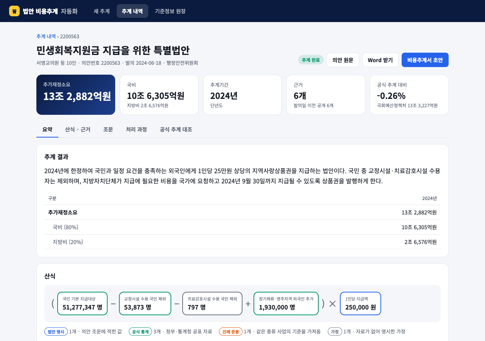
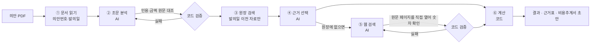
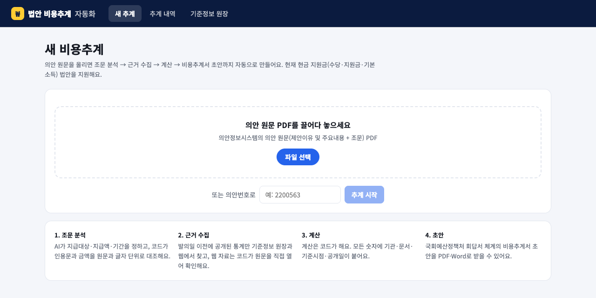
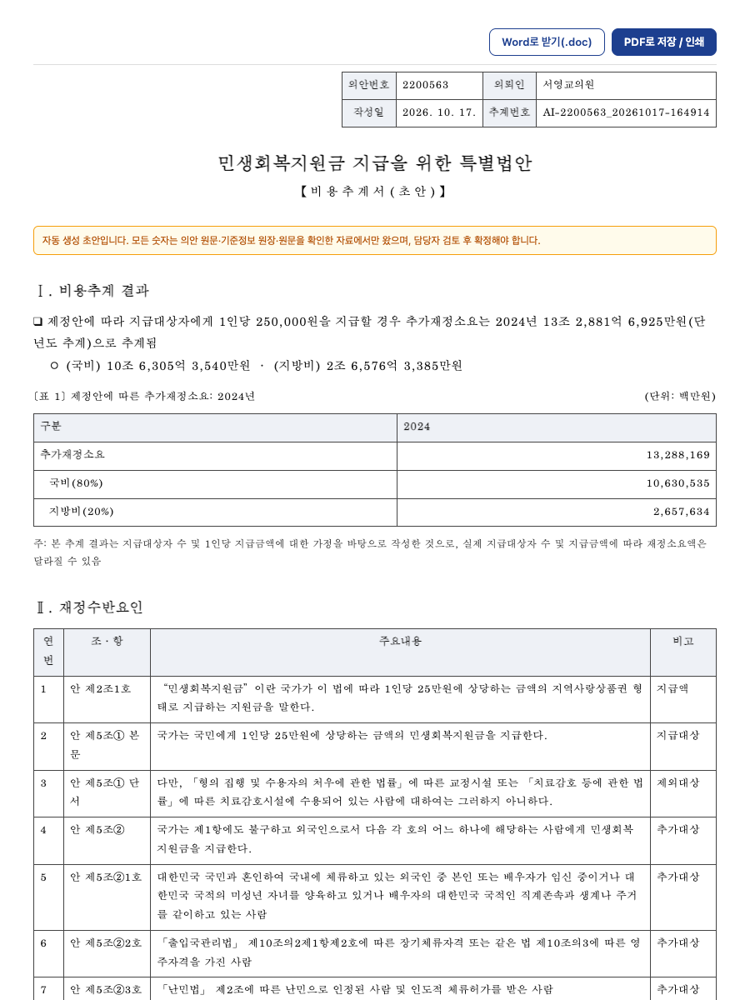

<div align="center">

# 법안 비용추계 자동화

**의안 원문 PDF를 올리면, 근거가 붙은 비용추계와 비용추계서 초안까지**

AI는 조문을 해석하고 근거를 고르는 **판단**만 합니다.
숫자는 법안 원문·기준정보 원장·코드가 직접 확인한 원문에서만 오고, 계산은 코드가 합니다.

</div>



## 무엇을 하나

| | |
|---|---|
| 입력 | 의안정보시스템의 의안 원문 PDF (현금 지원금 법안: 수당·지원금·기본소득) |
| 출력 | 연도별 추가재정소요, 국비·지방비, 산식, 근거표, 국회예산정책처 회답서 체계의 비용추계서 초안(PDF·Word) |
| 원칙 | 모든 숫자에 기관·문서·기준시점·공개일을 붙이고, **발의일 이후 공개된 자료는 쓰지 않음** |
| 검증 | 해당 의안의 공식 추계서를 보지 않고 실행한 결과를 국회예산정책처 추계와 대조 |

## 결과

AI가 해당 의안의 국회예산정책처 추계서를 보지 않은 상태에서 실행한 결과입니다.

| 의안 | 이 시스템 | 국회예산정책처 | 차이 |
|---|---:|---:|---:|
| 민생회복지원금 지급을 위한 특별법안 (2200563) | 13조 2,882억원 | 13조 3,227억원 | −0.26% |
| 2024년 민생위기 극복을 위한 특별조치법안 (2200037) | 12조 8,313억 ~ 17조 9,639억원 | 12조 8,193억 ~ 17조 9,471억원 | +0.09% |
| 청년농어민기본소득에 관한 법률안 (2211090) | 611억원 | 1조 825억원 | −94% |

청년농어민기본소득은 웹에서 찾은 통계가 "40세 미만 경영주 농가 수"(가구)라, 법안 대상인 "40세 미만 농어업인 수"(사람)보다 훨씬 작았습니다. 이후 가구 단위 통계를 코드가 거부하고 AI에게 다시 찾게 하도록 고쳤습니다.

## 어떻게 동작하나



| 단계 | 담당 | 하는 일 | 코드가 막는 것 |
|---|---|---|---|
| ① 문서 읽기 | 코드 | PDF 텍스트, 의안번호, 발의일 | — |
| ② 조문 분석 | AI | 지급대상·지급액·지급연도·추계 제외 항목 | 원문에 없는 인용문, 조문에 글자로 없는 금액 |
| ③ 원장 검색 | 코드 | 기준정보 원장에서 후보 수집 | 발의일 이후 공개 자료, 이 의안 자신의 정답값 |
| ④ 근거 선택 | AI | 조문 범위·기준시점이 맞는 행 선택 | 후보 밖 ID, 인원이 아닌 단위 |
| ⑤ 웹 검색 | AI | 원장에 없는 값만 공공기관 자료 우선 검색 | 원문에 숫자가 없는 자료, 가구 수를 사람 수로 쓴 자료 |
| ⑥ 계산 | 코드 | 단위 환산, 산식 계산, 합계 점검 | 0 이하 합계 |

### 기준정보 원장

추계에 쓰는 인원·단가·비율을 출처와 함께 모은 장부입니다. 국회예산정책처가 쓰는 "단가 및 기준정보" 표를 본떴습니다.

- **구성:** 직접 정리한 공식 통계 + 이전 엔진(ERCE) DB(읽기 전용) + 공개된 비용추계서 198건에서 뽑은 값 + 웹 검색으로 추가한 값
- **행마다 붙는 정보:** 값, 단위, 기관, 문서, 기준시점, 공개일, (추계서에서 뽑았다면) 출처 의안
- **검색:** "우리나라 인구"처럼 평소 말로 검색하면 동의어와 유사도로 찾습니다. 없으면 AI가 통계 용어로 바꿔 다시 찾고, 그래도 없으면 웹에서 찾아 원문을 확인한 뒤 원장에 추가합니다.

## 화면

| 새 추계 | 비용추계서 초안 |
|---|---|
|  |  |

- **새 추계:** PDF를 끌어다 놓거나 의안번호를 입력하면 진행률과 단계별 처리 내용이 실시간으로 보입니다.
- **추계 결과:** 요약 / 산식·근거 / 조문 / 처리 과정 / 공식 추계 대조 탭으로 구성됩니다. 산식의 숫자를 누르면 출처가 열리고, 조문마다 의안 PDF 해당 쪽으로 이동합니다.
- **근거를 못 찾은 값:** 직접 입력하면 AI를 다시 부르지 않고 바로 재계산합니다. 출처에는 "사용자 입력"으로 남습니다.
- **비용추계서 초안:** Ⅰ 비용추계 결과와 [표 1] → Ⅱ 재정수반요인 → Ⅲ 전제와 상세내역(각주에 자료 출처) → Ⅳ 검토 필요 사항 순서입니다.

## 실행

```bash
pip install -r requirements.txt
echo "OPENAI_API_KEY=sk-..." >> backend/.env

cd frontend && npm ci && npx vite build --config vite.nabo.config.js && cd ..
NABO_ACCESS_KEY=<접속 비밀번호> python3 -m backend.nabo_style.web    # http://localhost:8010
```

- 외부 공개: `cloudflared tunnel --url http://localhost:8010`
- 개발 모드: 비밀번호 없이 서버를 띄우고 `cd frontend && npx vite` → `http://localhost:5173/nabo.html`
- 읽기 전용 보관본(서버 없이 열림): `VITE_NABO_STATIC=1 npx vite build --config vite.nabo.config.js --outDir dist-static --base ./` 후 `python3 -m backend.nabo_style.export_static frontend/dist-static`
- AI 모델: `NABO_AI_MODEL`(기본 `gpt-6.1-sol`), `NABO_AI_EFFORT`(기본 `medium`)

## API

인증: `Authorization: Bearer <NABO_ACCESS_KEY>` (브라우저는 로그인 쿠키)

| 용도 | 방식 | 경로 |
|---|---|---|
| 추계 시작 (`pdf_b64` 또는 `bill_no`) | POST | `/api/nabo/ai/run` |
| 진행 상황·결과 | GET | `/api/nabo/ai/job/{job}` |
| 추계 내역 / 상세 | GET | `/api/nabo/ai/runs`, `/api/nabo/ai/run/{run_id}` |
| 값 직접 입력 후 재계산 | POST | `/api/nabo/ai/recompute` |
| 비용추계서 초안 (`?format=doc`이면 Word) | GET | `/api/nabo/ai/report/{run_id}` |
| 의안 원문 PDF | GET | `/api/nabo/ai/pdf/{run_id}` |
| 원장 검색 / AI 검색 / 웹 검색 / 원장 추가 | GET·POST | `/api/nabo/ledger`, `/ledger/ai`, `/ledger/web`, `/ledger/add` |

## 프로젝트 구조

```
backend/
  nabo_style/          ★ 서비스
    web.py               API 서버, 화면 서빙, 접속 비밀번호
    ai_pipeline.py       업로드 → AI 판단 → 코드 검증 → 계산
    support_payment.py   현금 지원금 산식 계산기 (모든 값에 근거 카드)
    ledger.py            기준정보 원장
    ledger_search.py     자연어 검색 → AI 검색어 변환 → 웹 검색 → 원장 추가
    report.py            비용추계서 초안
    export_static.py     읽기 전용 보관본 내보내기
    display.py           화면용 출처·단위 표기
    data/                직접 정리한 원장
    research/            원장·선례 구축에 쓴 연구용 스크립트
  erce/                이전 엔진 ERCE (원장 데이터 원천)
  erce_web/            ERCE 웹 서버와 부품 (python3 -m backend.erce_web.server)
  scripts/             의안 PDF 수집 등 데이터 수집 도구
  tests/               테스트 (python3 -m unittest discover -s backend -t . -p 'test_*.py')
  legacy/              지금 쓰지 않는 실험 엔진·스크립트·픽스처 (삭제 없이 보관)
  generated/           수집·가공 데이터 (git 제외)
frontend/
  nabo.html, src/nabo/ ★ 서비스 화면
  index.html, src/     ERCE 화면
docs/
  nabo_style/          시연 사례 비교 기록, 공식 추계 대조표
  erce/                ERCE 사례 기록
  images/              README 이미지
  career/  archive/    포트폴리오 문서, 이전 설계 문서·실험 기록
archive/               이전 산출물, 데이터 묶음, 서식 원본, 조례안 예시
```

## 지원 범위와 한계

- 현재 **현금 지원금**(사람에게 정액을 지급하는) 법안만 지원합니다. 다른 유형은 "현금 지원금 법안이 아니에요"로 안내합니다.
- 웹 검색으로 가져온 값의 공개일은 AI가 보고한 값이며, 화면과 원장에 그 사실을 표시합니다.
- 비용추계서는 **초안**이며 담당자 검토가 필요합니다.

## 라이선스

[MIT](./LICENSE)
